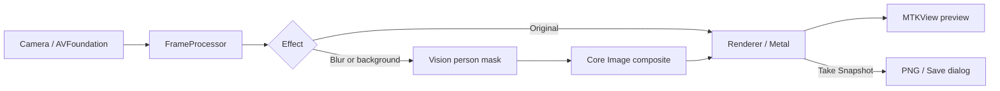

# LiveBackgroundReplacer

A macOS app for taking photos with a replaced or blurred background. Choose a
built-in background or upload your own image, preview the result live, and save
a PNG snapshot. Includes adjustable background blur and a mirrored preview.

Requires macOS 14.5+. Built with SwiftUI, Vision, Core Image, and Metal.


## Project structure

```text
LiveBackgroundReplacer/
├── LiveBackgroundReplacerApp.swift  # App entry point
├── ContentView.swift                # Main screen
├── UIComponents.swift               # Buttons and background gallery
├── WorkspaceModel.swift             # UI state, effects, imports, snapshots
├── VideoCameraController.swift      # Camera permissions and capture session
├── FrameProcessor.swift             # Person segmentation and compositing
├── Renderer.swift                   # Metal rendering and frame export
├── MetalView.swift                  # MTKView configuration
├── CameraViewRepresentable.swift    # SwiftUI bridge
├── Assets.xcassets/                 # Backgrounds, colors, and icons
└── LiveBackgroundReplacer.entitlements
LiveBackgroundReplacer.xcodeproj/    # macOS app project
Documentation/BackgroundAssets.md   # Generated background prompts
```

## Pipeline



1. **Start:** `WorkspaceModel` connects the components and requests camera capture.
   `VideoCameraController` checks permission and configures the session on `sessionQueue`.
2. **Process:** frames arrive on `processingQueue`. Original mode passes them through;
   other modes use Vision to generate a person mask, scale it to the frame, and blend
   the person with a blurred or replacement background using Core Image.
3. **Display:** the processed `CIImage` goes directly to `Renderer`, which applies
   mirroring and fits it into `MTKView` using a Metal-backed `CIContext`.
   Late capture frames are discarded, and only the latest pending frame is kept for display.
4. **Control:** SwiftUI sends effect changes through `WorkspaceModel`. Imported images
   are decoded on a background queue, added to the gallery, and selected automatically.
   Camera state, warnings, and metrics update the UI on the main queue.
5. **Save:** the snapshot button encodes the last rendered frame as PNG before opening
   the save dialog, preserving the effect and mirroring without UI controls or letterboxing.
